[**Portfolio**](https://tiru-venkatesh.github.io) &nbsp;·&nbsp; [**Email**](mailto:tiruvenkatesh123@gmail.com) &nbsp;·&nbsp; [**GitHub**](https://github.com/tiru-venkatesh)

I build web apps, backend systems, and AI-powered products: LLMs, agents, computer vision, and the engineering that turns ideas into useful software.

- Building **OPAI**, an operating-agent project exploring AI assistance, tools, and workflows
- Learning LLMs, RAG, AI agents, and Generative AI by shipping
- Building end to end: frontend, backend, APIs, cloud
- Sharing the journey as **Tiru Builds** · **@lockintiru**

> Understand the problem, build a working version, test it, learn from what breaks, improve it.

   
  

<table>
<tr>
<td width="50%"></td>
<td width="50%"></td>
</tr>
<tr>
<td></td>
<td></td>
</tr>
<tr>
<td></td>
<td></td>
</tr>
<tr>
<td></td>
<td></td>
</tr>
</table>

More: [Gynex-AI](https://github.com/tiru-venkatesh/Gynex-AI) · [CodeStream](https://github.com/tiru-venkatesh/codestream) · [Image to Excel AI](https://github.com/tiru-venkatesh/img2xl-backend-3). Projects evolve, so check each repository for its current status.

- Google Cloud Gen AI Academy APAC Hackathon: Civic-IQ team reported Top 101 (Rank 91)
- PromptWars Virtual Challenge 3: reported among the Top 400
- Google Cloud Asia Pacific: Best of Next '26 credential

Learning from real codebases: Python and backend systems, AI/ML tooling, docs and tests, developer experience.

